<div align="center">
  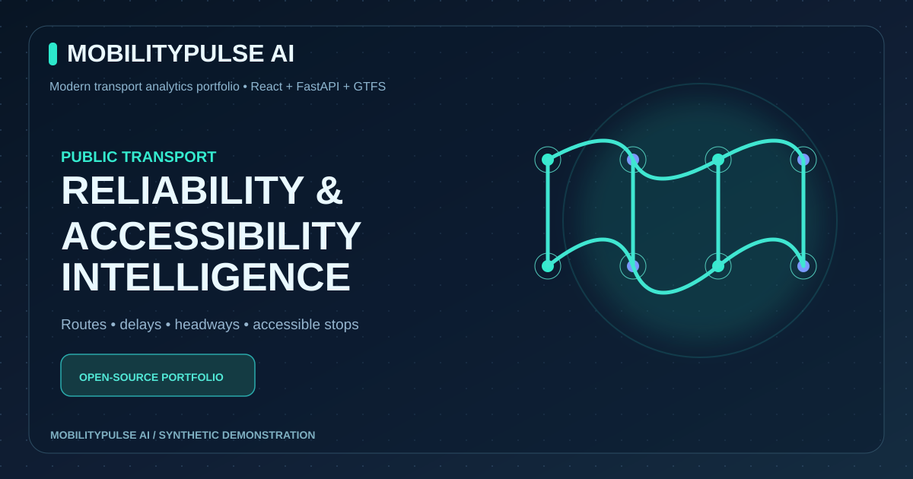
  <h1>MobilityPulse AI</h1>
  <h3>Public Transport Reliability & Accessibility Intelligence</h3>
  <p>React · FastAPI · Python · Pandas · GTFS · Scikit-learn · Docker · GitHub Actions</p>
  <p>
    <a href="#quick-start">Quick start</a> · <a href="#visual-gallery">10 Visuals</a> · <a href="#project-tree">Source tree</a> · <a href="docs/ARCHITECTURE.md">Architecture</a> · <a href="portfolio/index.html">Portfolio</a>
  </p>
  
  
  
  
</div>

## Project overview

**MobilityPulse AI** is an end-to-end **portfolio demonstration** for exploring route reliability, arrival delay patterns, stop accessibility metadata, and data-feed diagnostics. It combines GTFS Schedule ingestion, data quality checks, historical observed-event analytics, offline machine-learning evaluation, an API, a responsive React dashboard, and Power BI export tooling.

> ⚠️ **Not a public transport service:** The default 4 routes, 12 stops, and historical observations are explicitly **fictional, deterministic synthetic demonstration data**. The project does **not** offer verified vehicle positions, real-time arrivals, accessibility guarantees, or real transit advisories. The displayed "on time" figures describe synthetic observed events only.

## Core capabilities

| Area | Features |
|---|---|
| React UI | Overview, route explorer, stop details, reliability, accessibility, feed health |
| Python API | FastAPI endpoints with explicit provenance metadata |
| GTFS Schedule | Read ZIPs, validate required tables/columns, coordinate range and key references |
| Historical analytics | On-time windows, average delay, P90 delay, observed stop headways |
| Accessibility | Preserve GTFS wheelchair_boarding 0 as unknown, 1 reported accessible, 2 reported inaccessible |
| ML demo | RandomForest delay regression with chronological service-date split and baseline comparison |
| GTFS-Realtime | Offline parser diagnostics for TripUpdates, VehiclePositions and Alerts |
| Operations | Docker Compose, CI, optional import paths, monitoring helper modules |
| Reporting | Reproducible Power BI/Excel CSV exports and sample DAX |
| Portfolio | Standalone HTML case study, docs and ten custom SVG graphics |

<a id="visual-gallery"></a>
## Visual gallery

| Architecture | ETL / Pipeline |
|---|---|
| 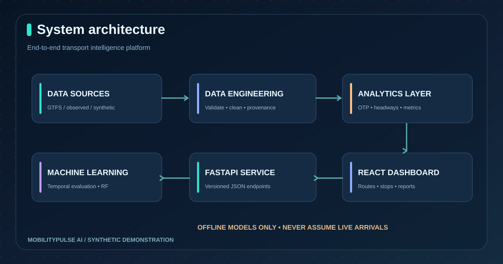 | 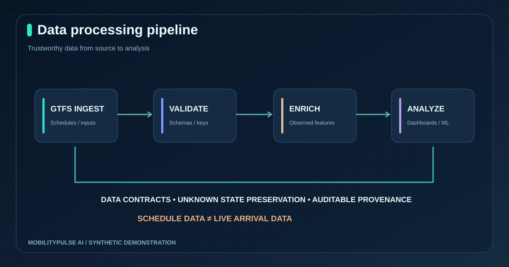 |

| GTFS entity relationships | Fictional transit route map |
|---|---|
| 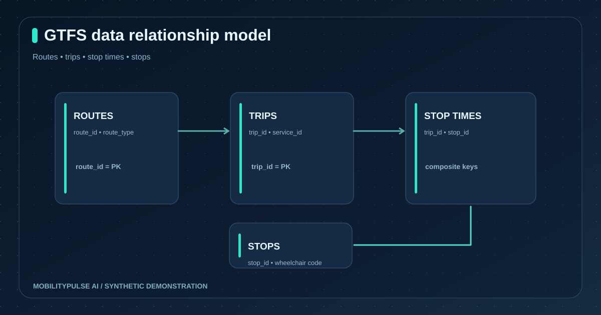 | 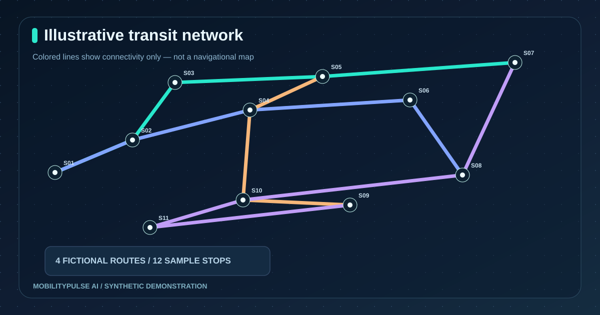 |

| Example route reliability | Illustrative delay distribution |
|---|---|
| 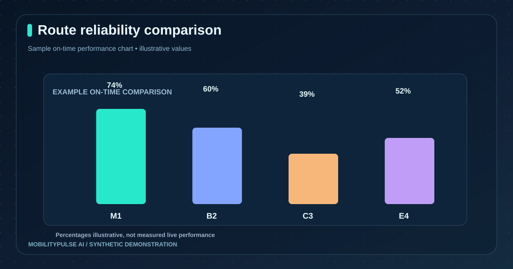 | 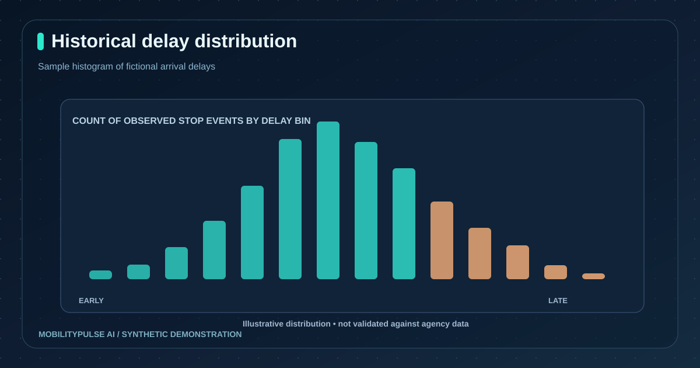 |

| Conceptual headway trend | Accessibility metadata |
|---|---|
| 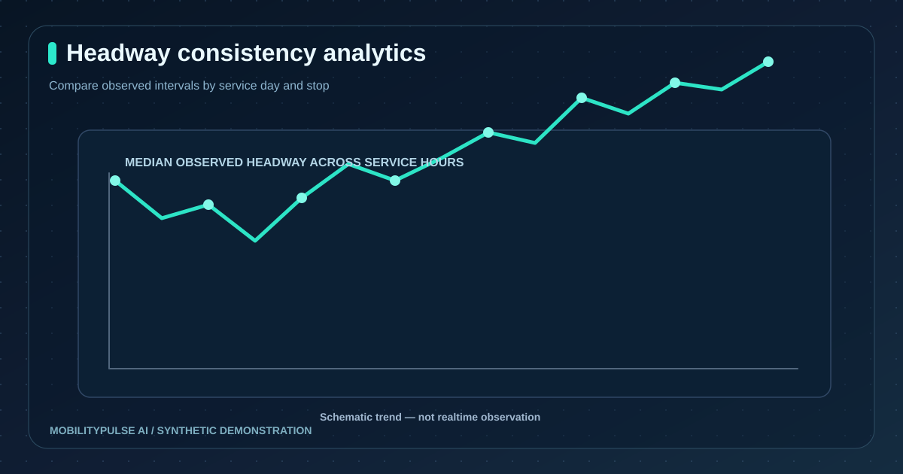 | 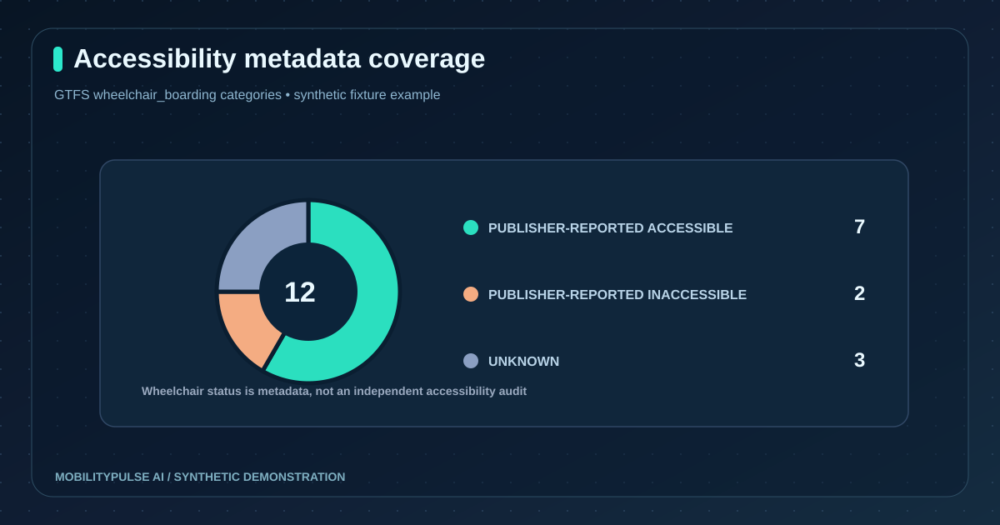 |

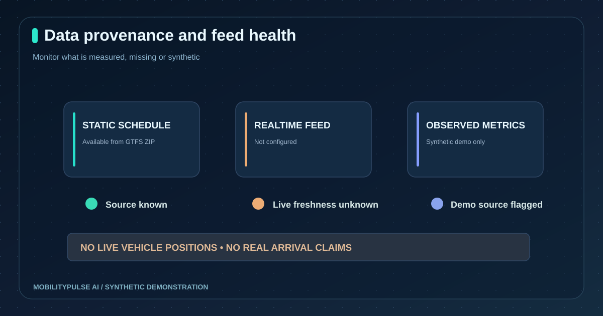

**All ten original SVG graphics:** [Browse gallery](assets/README.md). Charts embedded in the React dashboard are computed from its current API data; illustrations above are examples, not factual transit claims.

## System workflow

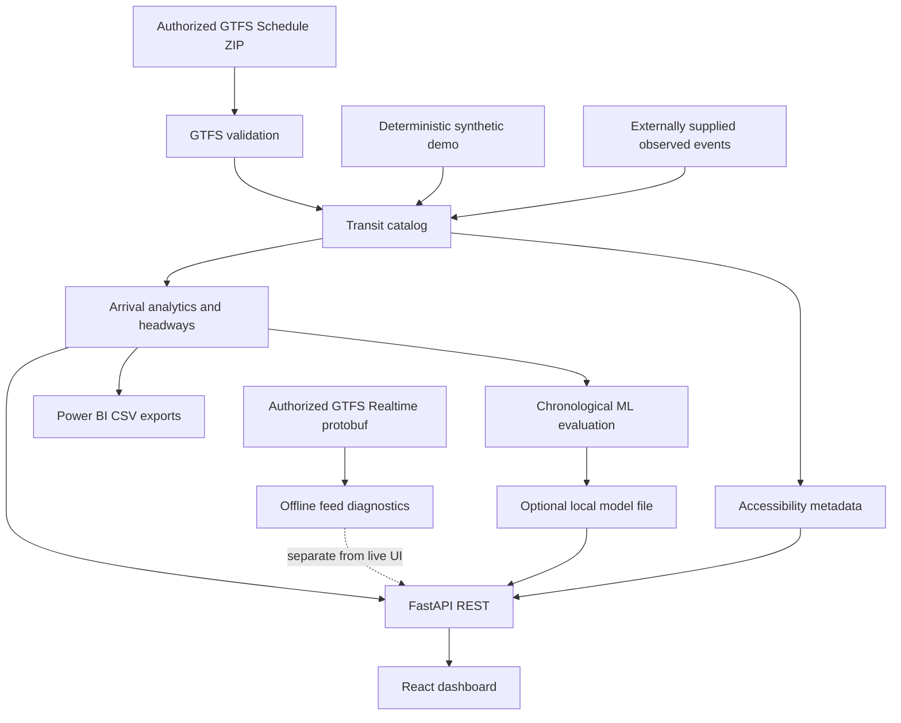

## Public portfolio and offline interactive dashboard

The project includes a GitHub Pages workflow that publishes the recruiter portfolio and React dashboard **using frozen synthetic JSON snapshots**, not a live transit backend.

- After GitHub Pages is enabled and deployment succeeds: [Portfolio](https://harshakavali81-collab.github.io/MobilityPulse-AI-Public-Transport-Reliability-Accessibility-Intelligence/portfolio/)
- After GitHub Pages is enabled and deployment succeeds: [Interactive synthetic dashboard](https://harshakavali81-collab.github.io/MobilityPulse-AI-Public-Transport-Reliability-Accessibility-Intelligence/demo/)
- [Pages deployment instructions](docs/STATIC_DEPLOYMENT.md), [Authorized realtime feed diagnostics](docs/LIVE_DATA_INTEGRATION.md), [API security limits](docs/SECURITY_HARDENING.md)

**One-time owner action needed:** In GitHub → Settings → Pages → Build and deployment → Source, choose **GitHub Actions**. Until activated, the workflow builds and stores a downloadable site ZIP instead of reporting a false deployment success. Do not treat public links as live until the Deploy job succeeds.

## Hyderabad GTFS Schedule — optional real source

TGSRTC publishes static GTFS schedules via its open-data initiative. The optional **opt-in** downloader runs after you have reviewed the provider's terms:

```bash
python scripts/download_hyderabad_schedule.py --accept-provider-terms
GTFS_ZIP_PATH=data/raw/hyderabad_tgsrtc_gtfs.zip uvicorn backend.app.main:app
```

The download is **not automatic**. The GTFS data is schedule-only; observed punctuality remains unavailable without separately validated historical arrivals. [Source and data limitations](docs/HYDERABAD_FEED.md).

A separate [GTFS-Realtime predictions API](docs/LIVE_DATA_INTEGRATION.md) is also implemented for explicitly authorized live protobuf sources. Publisher predictions are **not actual arrival observations**.

## Quick start

**Requirements:** Python 3.10+, Node.js 20.19+ or 22+, and internet access for dependency installation.

```bash
git clone https://github.com/harshakavali81-collab/MobilityPulse-AI-Public-Transport-Reliability-Accessibility-Intelligence.git
cd MobilityPulse-AI-Public-Transport-Reliability-Accessibility-Intelligence
python -m pip install -r requirements.txt
python -m pip install -e .
python scripts/generate_demo.py
uvicorn backend.app.main:app --reload --port 8000
```

Open a second terminal:

```bash
cd frontend
npm install
npm run dev
```

- **Dashboard:** http://localhost:5173
- **API:** http://localhost:8000/api/health
- **Swagger API documentation:** http://localhost:8000/docs
- **Docker alternative:** `docker compose up --build` → http://localhost:8080

### Test and export

```bash
pytest -q
python scripts/export_powerbi.py
python -m mobilitypulse.models.train_delay_model --allow-synthetic
```

The model command writes local `data/processed/delay_model.joblib` and metadata with an evaluation vs. median baseline. Outputs are **experimental and synthetic**, not certified operational forecasts. They are gitignored.

### Integrating an authorized feed

Set `GTFS_ZIP_PATH` to a permitted static GTFS archive and optionally `OBSERVATIONS_CSV_PATH` to a separate file containing actual arrival observations. Use `uvicorn --env-file .env` after installing `python-dotenv` (or export variables in the shell). Never label Schedule-derived times as live observations. If a GTFS Schedule ZIP has no actual observations, the API reports `on_time_pct: null`, not fabricated punctuality.

See [API guide](docs/API.md), [data provenance](docs/DATA_ETHICS.md), and [deployment](docs/DEPLOYMENT.md) for caveats.

## API overview

| Endpoint | Description |
|---|---|
| `GET /api/health` | Service readiness |
| `GET /api/overview` | Summary with dataset provenance |
| `GET /api/routes` | Routes and identifiers |
| `GET /api/routes/{id}` | Route and ordered stops |
| `GET /api/stops`, `/api/stops/{id}` | Stop metadata |
| `GET /api/analytics/reliability` | Route observed-event metrics |
| `GET /api/analytics/trends` | Day-level observed metrics |
| `GET /api/analytics/headways` | Same-stop consecutive actual arrivals |
| `GET /api/accessibility` | Publisher wheelchair metadata |
| `GET /api/alerts`, `/api/feed/status` | Sample notices and feed availability |
| `POST /api/delays/predict` | Optional offline model estimate (503 if not trained) |

## Project tree

```text
MobilityPulse-AI/
├── README.md, LICENSE, .env.example, requirements.txt, pyproject.toml
├── .github/workflows/ci.yml
├── assets/                      # 10 original vector images
├── backend/
│   ├── app/main.py             # FastAPI entry
│   ├── app/db/store.py         # Source-aware dataset catalog
│   ├── app/routes/             # Route / stop / analytic / access / ML endpoints
│   └── Dockerfile
├── src/mobilitypulse/
│   ├── ingestion/              # Static GTFS, GTFS-RT, observations
│   ├── processing/             # GTFS validation
│   ├── analytics/              # OTP / route comparison / headways
│   ├── models/                 # RandomForest training / inference
│   └── monitoring/             # Freshness / anomaly detection
├── frontend/
│   ├── src/pages/              # Dashboard, Routes, Stops, Reliability, Access, Feed
│   ├── src/components/         # Recharts + SVG route schematic
│   ├── src/api/                # Typed responsibility / centralized requests
│   ├── src/styles.css
│   └── Dockerfile
├── data/                       # Synthetic fixture generated locally
├── notebooks/                  # EDA / reliability / modeling walkthroughs
├── powerbi/                    # Reproducible CSVs, DAX guide
├── portfolio/                  # Recruiter-facing HTML case study
├── scripts/                    # Dataset generation / exports / diagnostics
├── tests/                      # API / analytics / GTFS / ML
└── docs/                       # Methodology, architecture, safety, deployment
```

## Limitations and ethics

- Metrics need observed events, not merely GTFS schedules.
- Imported observations are **externally supplied and not independently verified**.
- Stop-event cancellation counts are **not** distinct cancelled trips.
- Location points are fictional and must not be used for navigation.
- Static accessibility codes cannot certify elevator or ramp availability.
- No valid realtime source is preconfigured. Feed health indicates missing status.
- The delay model uses demonstration events; **never use it as a safety-critical operational forecast**.
- Production deployment, auth, data licensing, monitoring infrastructure, and external agency approval are not included.

## For recruiters

This case study demonstrates Python ETL, analytical SQL concepts, frontend visualization, API contracts, ML evaluation, validation/testing, and transparent data provenance. [Read portfolio case study](portfolio/CASE_STUDY.md) and [interview walkthrough](docs/INTERVIEW.md).

**License:** MIT. Independent portfolio project; not endorsed by a transport operator.

**Reference specifications:** [GTFS Schedule](https://gtfs.org/documentation/schedule/reference/) · [GTFS Realtime](https://gtfs.org/documentation/realtime/reference/)
