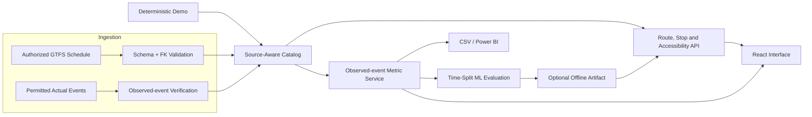

# Architecture and source-of-truth boundaries

## Responsibilities

The data mode field identifies `synthetic`, `schedule_only`, or `externally_supplied_observations`. The externally supplied category is **not a certification of correctness**. The application does not mix GTFS schedules into the set of actually observed arrivals. A configured ZIP with no observation CSV returns null delay/OTP values. No persistent hosted database is included: the backend in this portfolio holds a per-process cached catalogue. Adding production storage requires migration, credentials, retention design, authentication and data licensing.
