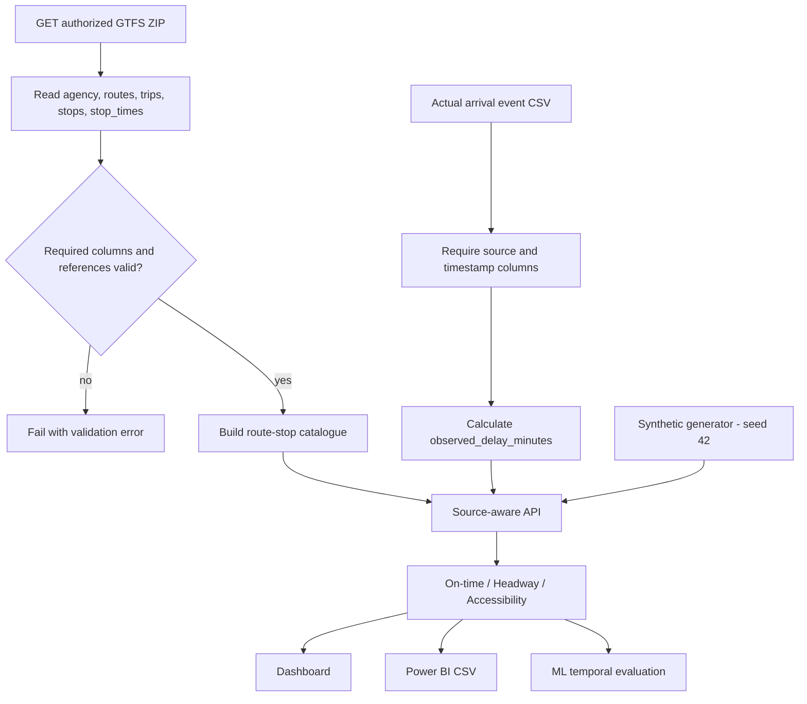

# Data pipeline and lineage

**Data contracts:** Schedule defines planned service. Observed arrivals require genuine actual timestamps and traceable source. Explicit cancellation flags are recorded separately from observed service. On-time windows are defined in [metrics](METRICS.md). Unknown stop accessibility values remain unknown. An actual trip source needs agency approval and independent review before operational use.
