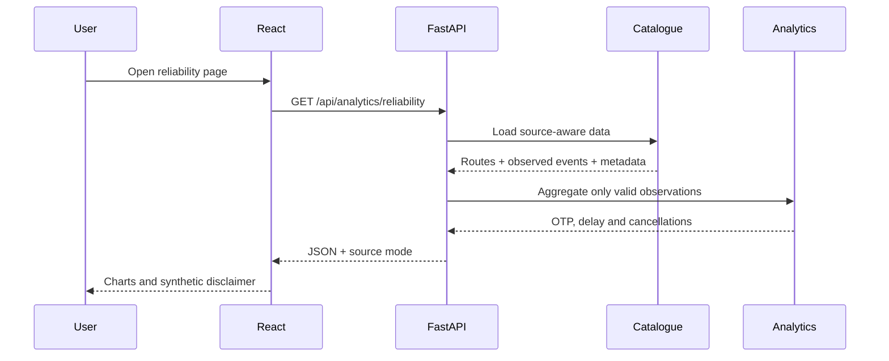
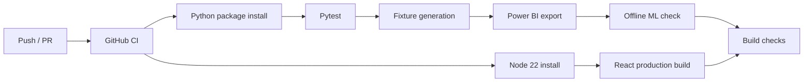

# Project workflow and request lifecycle

## Dependencies

- Python 3.10+, Node 22 recommended.
- Inputs: GTFS Schedule ZIP plus, optionally, an independently sourced observed arrival CSV.
- No GTFS-RT feed, account credentials, or operational data is preconfigured.
- Real public hosting requires an external HTTPS API and separately hosted React static files.
